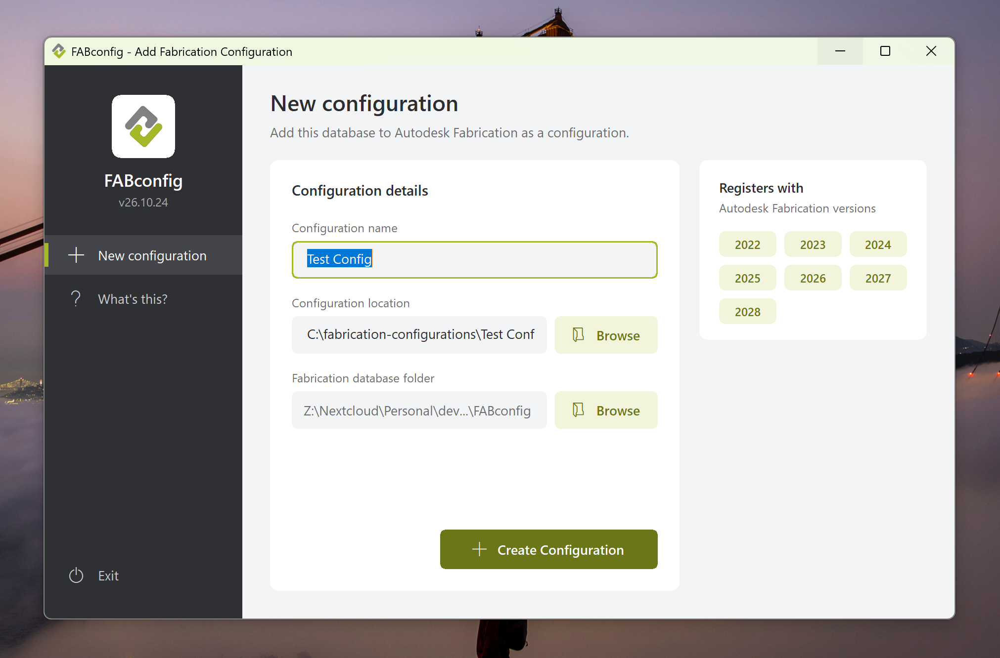

# FABconfig

FABconfig adds an Autodesk Fabrication database to Fabrication (Revit, CADmep, ESTmep, CAMduct) as a named configuration, so the database appears in Fabrication's configuration list at start-up. It creates the configuration folder, writes a `map.ini` that points back to the shared database, and registers the configuration with each recent Fabrication version, all in one click.



FABconfig is written in [AutoHotkey v2](https://www.autohotkey.com/) and can be run as a script or compiled into a standalone `.exe`. It is developed by Virtual Building Supply, LLC and released under the GNU General Public License v3.

## Requirements

- Windows 10 or 11. The icons use the Segoe MDL2 Assets font that ships with both.
- [AutoHotkey v2.0](https://www.autohotkey.com/) or later, to run or compile the script. Users of a compiled `.exe` don't need AutoHotkey.
- Autodesk Fabrication, for the configuration to be of any use.

No administrator rights are needed. FABconfig writes only to the current user's registry (`HKEY_CURRENT_USER`) and to the configuration folder you choose.

## How to use it

1. **Give the database a name (once per database).** Open the database's `map.ini` in Notepad. If it doesn't have a `[COMPANY-INFO]` section, add these lines at the end, put in your database's name, and save:
   ```ini
   [COMPANY-INFO]
   DBNAME=Your database name
   ```
   Autodesk Fabrication doesn't add this section; Virtual Building Supply adds it when building a database, so databases from VBS already have it. FABconfig uses it to fill in the configuration name for everyone who sets up this database. The name can't contain `\ / : * ? " < > |`. This step is optional: without it, each user types a name instead.
2. Copy the compiled `.exe` (or `FABconfig.ahk` together with the `Resources` folder) into the root folder of the Fabrication database, next to its `map.ini`. You can also run FABconfig from anywhere else: if there's no `map.ini` in its folder, it asks you to choose the database folder when it starts.
3. The configuration name is filled in from `DBNAME` in the `[COMPANY-INFO]` section of the database's `map.ini`, if there is one. If there isn't, type a name; the location still starts at `C:\fabrication-configurations\` and follows the name.
4. Check the name, location and database folder, then click **Create Configuration** (or press Enter). Use the **Browse** button beside the database folder to pick a different database.
5. Start Fabrication. The new configuration appears in the configuration list.

The **What's this?** page in the sidebar explains each step inside the program. Esc returns from that page, or closes the program from the main page.

## What it changes

- **Configuration folder:** Created at `C:\fabrication-configurations\<name>` by default. The location follows the name as you type, until you edit it or choose a folder with **Browse**.
- **map.ini:** Written to the configuration folder. It points the `Database`, `Items`, `Images`, `Profiles`, `Reports` and `Scripts` paths at the shared database. `Projects`, DXFs, `Blocks` and `Backup` stay in the configuration folder, so each user's local work stays separate from the shared database. Its first line, `# Created by Virtual Building Supply, LLC`, marks the configuration as made by FABconfig.
- **config.png:** Copied from the database folder into the configuration folder, if present. Fabrication shows this picture in its configuration list.
- **Registry:** For each Fabrication version from four years before the current year to two years after it (and any other version the configuration was already registered with), writes the configuration folder to the `Path` value under
  `HKEY_CURRENT_USER\Software\Autodesk\Fabrication <year>\Configuration\<name>`.

Nothing in the database folder itself is changed. Running FABconfig again with the same name updates that configuration.

### Safety checks

- The name can't contain characters Windows doesn't allow in folder names.
- The configuration folder must be a full path, and can't be the database folder, a folder that contains it, or a folder inside it. (A folder inside the database would also be deleted by tools that mirror the database, such as `robocopy /MIR`.)
- A database folder must contain a `map.ini` or a `DATABASE` folder, and can't be a configuration folder (one whose `map.ini` points to a database somewhere else). If you pick one that doesn't qualify, FABconfig asks you to choose again.
- If a configuration with the same name already exists, FABconfig shows which Fabrication versions it's registered with and where it points (and warns if it wasn't made by FABconfig), then asks before overwriting it. It checks every Fabrication version in the registry, not just the range above, and an overwrite updates all of them. If the name is new but the chosen folder already has a `map.ini`, it asks before overwriting that too. Whenever it overwrites a `map.ini`, the previous one is kept next to it as `map.ini.bak` (only the most recent one is kept).
- If any file can't be written or any registry entry can't be saved, FABconfig says so instead of reporting success.

### Removing a configuration

To remove a configuration by hand, delete its `Configuration\<name>` key under each `HKEY_CURRENT_USER\Software\Autodesk\Fabrication <year>` key, then delete the configuration folder. Close Fabrication first.

## Building the .exe

1. Make sure the `Resources` folder sits next to the script. The compiler builds `Resources\VBS_Logo.ico` (the `.exe` icon) and `Resources\VBS_Logo_Badge.png` (the sidebar logo) into the `.exe`.
2. Right-click the script and choose **Compile Script**. If that option isn't there, open **AutoHotkey Dash** and choose **Compile**, which installs the compiler (Ahk2Exe) the first time.
3. Choose a **v2** base file (for example `AutoHotkey64.exe`) and click **Convert**.

The compiled file is named after the version, for example `FABconfig_v26.10.24.exe`, and is saved next to the script. The icon, version and copyright details come from the `;@Ahk2Exe-` lines in the script; the version is copied from `APP_VERSION`, so there's nothing else to update. These lines need a recent version of Ahk2Exe. Both logos are inside the `.exe`, so it runs on its own without the `Resources` folder. The script (`.ahk`) reads them from the `Resources` folder instead, and shows plain icons if it's missing.

Some antivirus tools are wary of unsigned `.exe` files compiled from AutoHotkey. Signing the `.exe` with a code-signing certificate avoids this.

## Versions and releases

Versions are dates in the form `vYY.MM.DD` (for example `v26.10.24`). A second release on the same day adds a fourth number: `v26.10.24.1`. The version is shown in the sidebar and in the `.exe`'s file properties.

The script keeps the same file name from version to version; past versions are in the git history and on the [Releases](../../releases) page. To make a release:

1. Set `APP_VERSION` near the top of `FABconfig.ahk`. This is the only place the version is written.
2. Move the **Unreleased** notes in [CHANGELOG.md](CHANGELOG.md) under a heading for the new version.
3. Compile the `.exe` (see above), commit, and tag the commit with the version: `git tag v26.10.24`, then `git push --tags`.
4. Create a GitHub release from the tag, paste in its changelog notes, and attach the `.exe`.

## Repository layout

```
FABconfig.ahk             The program
Resources/                VBS logo files (not covered by the GPL, see below)
  VBS_Logo.ico            Window, taskbar and .exe icon
  VBS_Logo_Badge.png      Logo shown in the sidebar
docs/
  screenshot.png          Screenshot of the main window, shown above
CHANGELOG.md              What changed in each version
LICENSE                   GNU General Public License v3
README.md                 This file
```

## Contributing

Bug reports, suggestions and pull requests are welcome. Please describe what you changed and how you tested it, including the Windows version, Fabrication version and display scaling you tried. Contributions are accepted under the same license as the project.

## License

Copyright (C) 2026 Virtual Building Supply, LLC. Author: Scott Hendricks.

FABconfig is free software: you can redistribute it and/or modify it under the terms of the GNU General Public License as published by the Free Software Foundation, either version 3 of the License, or (at your option) any later version. It is distributed in the hope that it will be useful, but **without any warranty**; without even the implied warranty of merchantability or fitness for a particular purpose. See [LICENSE](LICENSE) for the full text.

Additional terms under section 7 of the GPL v3, also stated in the script's header:

- **Attribution (section 7b):** The copyright notice and author attribution in the script's header must be preserved in that file and in any modified version of it.
- **Trademarks (section 7e):** The license grants no rights to use the trade names, trademarks or logos of Virtual Building Supply, LLC, including the logo files in the `Resources` folder. If you distribute a modified version, replace those files with your own (or remove them) and change the program's branding. FABconfig runs without them; to compile without the logos, remove the `;@Ahk2Exe-SetMainIcon` and `;@Ahk2Exe-AddResource` lines.

Autodesk, Revit, Fabrication, CADmep, ESTmep and CAMduct are registered trademarks or trademarks of Autodesk, Inc. FABconfig is not affiliated with, endorsed by or supported by Autodesk.
